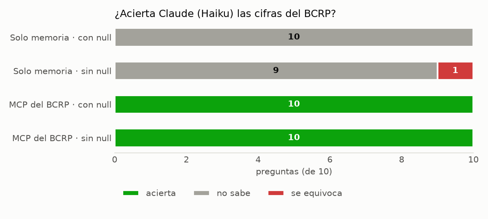

# Informe: ¿Acierta Claude las cifras del BCRP con y sin un servidor MCP propio?

Frank Pinares Gutiérrez · 28 de octubre de 2026 · Diplomatura de Especialización en Ciencia de Datos para CCSS y
Gestión Pública (Q-LAB PUCP), curso de Python Intermedio

## Introducción

El presente informe tiene como objetivo evaluar si un modelo de lenguaje responde con mayor precisión preguntas sobre
cifras oficiales cuando tiene acceso a una fuente de datos mediante el Model Context Protocol (MCP) que cuando
responde únicamente a partir de su memoria. Para ello, se construyó un servidor MCP propio (`server.py`, desarrollado
con FastMCP 4.1.4) que da acceso a las 17,167 series del Banco Central de Reserva del Perú (BCRP), y se le planteó a
Claude **Haiku** un conjunto de 10 preguntas con respuesta numérica verificable, primero sin herramientas y luego con
el mencionado servidor. Debe señalarse que el servidor supera las 8 pruebas de `test_server.py`
(`uv run pytest -q` → `8 passed`), las cuales comprueban con datos reales que sus herramientas devuelven las cifras
correctas.

## 1. Resultados



Se realizaron dos corridas de `evaluar.py`. La primera, o corrida base, mantuvo la instrucción original que le pedía
al modelo responder `null` en caso de no poder conocer la cifra con certeza; la segunda, que corresponde al
experimento adicional, eliminó dicha instrucción. Los resultados de ambas corridas se resumen en la siguiente tabla:

| Corrida | Modo | Acierta | No sabe | Se equivoca | Segundos por pregunta |
|---|---|---|---|---|---|
| Base (con la instrucción de responder `null`) | Solo memoria | 0 | 10 | 0 | 6.7 |
| Base (con la instrucción de responder `null`) | MCP del BCRP | **10** | 0 | 0 | 17.3 |
| Experimento (sin la instrucción de responder `null`) | Solo memoria | 0 | 9 | **1** | 7.4 |
| Experimento (sin la instrucción de responder `null`) | MCP del BCRP | **10** | 0 | 0 | 17.4 |

Los datos de cada corrida se encuentran en `resultados.csv` y `resultados_base.csv`, que corresponden a la corrida base
y son idénticos entre sí, así como en `resultados_sin_null.csv`, que corresponde al experimento. Asimismo, la
siguiente tabla detalla el valor obtenido en cada pregunta durante la corrida base:

| id | Serie | Verdad | MCP | Memoria |
|---|---|---|---|---|
| ipc_set26 | PN01273PM | 4.5487 | 4.5487 | no sabe |
| ipc_dic25 | PN01273PM | 1.5088 | 1.5088 | no sabe |
| ipc_mar25 | PN01271PM | 0.8102 | 0.8102 | no sabe |
| referencia_set26 | PD04722MM | 4.25 | 4.25 | no sabe |
| tc_15oct26 | PD04638PD | 3.4282 | 3.4282 | no sabe |
| rin_ago26 | PN00027MM | 96517.9 | 96517.9058 | no sabe |
| cobre_ago26 | PN38784BM | 689.70 | 689.6988 | no sabe |
| pbi_2025 | PM04923AA | 3.4306 | 3.4306 | no sabe |
| **desempleo_set26** (propia) | PN38063GM | 4.4 | 4.3717 | no sabe |
| **expectativa_set26** (propia) | PD12912AM | 3.09 | 3.0875 | no sabe |

## 2. Análisis de los aciertos y errores

En primer lugar, se tiene que con el servidor MCP del BCRP el modelo acertó las 10 preguntas en ambas corridas. Cada
respuesta requirió entre 4 y 6 turnos, es decir, varias llamadas a herramientas, y si bien `resultados.csv` no registra
cuáles fueron, en la prueba interactiva realizada en Claude Code se pudo observar que el modelo primero buscaba el
código de la serie con `buscar_series` y luego obtenía la cifra con `resumen` o `serie`. Asimismo, en la columna
`fuente` el modelo citó en todos los casos el código de la serie, el periodo y la URL de la API consultada, como por
ejemplo `https://estadisticas.bcrp.gob.pe/estadisticas/series/api/PN01271PM/json/2025-3/2025-3`. Y es que la
explicación de estos aciertos radica en que la cifra no proviene del modelo, sino de una llamada a la API del BCRP que
cualquiera puede repetir, a la vez que las operaciones aritméticas las realiza Python y no el modelo. Sin embargo, debe
considerarse que este procedimiento tiene un costo en tiempo, siendo que cada pregunta tomó alrededor de 17 segundos
frente a los 7 segundos de las respuestas basadas solo en la memoria.

Por otra parte, en la corrida base el modelo sin herramientas no acertó ninguna pregunta y respondió «no sé» en las
10, cumpliendo así la instrucción de no estimar cuando no pudiera conocer la cifra con certeza. En sus explicaciones,
el modelo señaló que no contaba con herramientas para consultar al BCRP o al INEI y que su conocimiento llegaba hasta
junio de 2026. Cabe destacar que también se abstuvo de responder en el caso de cifras anteriores a dicha fecha, como
la inflación de marzo de 2025 o el crecimiento del PBI en 2025, lo cual sugiere que no recordaba estos valores con la
precisión que exigía la tolerancia establecida y que, en consecuencia, optó por no estimarlos.

Ahora bien, en el experimento adicional se ejecutó `uv run evaluar.py --sin-null --salida resultados_sin_null.csv`,
que elimina de la instrucción la frase que permitía responder `null`. En este escenario, el modelo continuó
respondiendo `null` en 9 de las 10 preguntas, en tanto el esquema JSON de la respuesta todavía lo permitía y el modelo
reconocía no tener acceso a los datos. No obstante, en la pregunta sobre el **crecimiento del PBI en 2025** el modelo
sí ofreció una cifra, **3.0%**, frente al **3.43%** oficial, y justificó su respuesta señalando que esta «proviene de
mi conocimiento de las proyecciones publicadas por el BCRP a finales de 2025, no del dato oficial de cierre». Este
resultado constituye un caso típico de cifra inventada, en tanto se trata de un valor plausible y debidamente
justificado, pero que no corresponde al dato oficial. De esta forma, se observa que al retirar la salida fácil de
responder «no sé», el modelo pasó a estimar justamente en la pregunta sobre la cual tenía información aproximada en
su memoria. Por el contrario, con el servidor MCP los resultados no variaron, siendo que el modelo acertó nuevamente
las 10 preguntas al no tener necesidad de estimar ninguna cifra.

## 3. Cifras comprobadas manualmente en la web del BCRP

Con el fin de verificar la veracidad de las respuestas obtenidas, se compararon las cifras que devolvió el servidor
MCP para las dos preguntas propias con las tablas publicadas en la web del BCRP, las cuales fueron revisadas
directamente en el navegador. Los resultados de esta comparación se presentan a continuación:

| Serie | Periodo | Web del BCRP | Servidor MCP | Diferencia |
|---|---|---|---|---|
| PN38063GM · Tasa de desempleo de Lima Metropolitana, promedio móvil tres meses (%) | setiembre de 2026 (`Sep26`) | **4.4** | 4.3717 | 0.03, debido a que la web redondea a un decimal |
| PD12912AM · Expectativa de inflación a 12 meses (%) | setiembre de 2026 (`Sep26`) | **3.09** | 3.0875 | 0.003, debido a que la web redondea a dos decimales |

Las tablas consultadas fueron las de las series
[PN38063GM](https://estadisticas.bcrp.gob.pe/estadisticas/series/mensuales/resultados/PN38063GM/html/2026-1/2026-10/) y
[PD12912AM](https://estadisticas.bcrp.gob.pe/estadisticas/series/mensuales/resultados/PD12912AM/html/2026-1/2026-10/).
En ambos casos, la diferencia se explica únicamente por el redondeo de la web y se encuentra dentro de la tolerancia
de 0.05 establecida en `preguntas.csv`.

## Conclusiones

Una primera conclusión a partir de este ejercicio es que el acceso a una fuente oficial mediante un servidor MCP
mejoró de manera sustancial la precisión del modelo, siendo que, con las mismas 10 preguntas y el mismo modelo, se
pasó de 0 a 10 aciertos, y cada cifra fue acompañada de su serie, su periodo y su URL. Una segunda conclusión es que,
sin la instrucción de abstenerse, el modelo empezó a inventar cifras, como se evidenció en el caso del crecimiento del
PBI en 2025, cuyo valor estimado se situó 0.43 puntos porcentuales por debajo del dato oficial. En ese sentido, la
construcción de un servidor MCP resulta pertinente cuando las preguntas se repiten sobre una misma fuente oficial que
cuenta con una API, cuando se requieren cifras exactas y verificables o cuando es necesario realizar cálculos sobre los
datos. Por otra parte, la búsqueda web podría ser suficiente para consultas ocasionales y de temas variados, si bien
debe precisarse que esta modalidad no fue evaluada en el presente informe, siendo que como referencia se tiene la
demostración del profesor, en la cual acertó 7 de 8 preguntas, tardó alrededor de 26 segundos por pregunta y falló en
la pregunta sobre el precio del cobre.

## Reproducción de la medición

```bash
uv run pytest -q                                              # 8 passed
uv run evaluar.py                                             # corrida base → resultados.csv
uv run evaluar.py --sin-null --salida resultados_sin_null.csv # experimento
uv run graficar.py                                            # grafico.png
```

Finalmente, debe señalarse que se realizaron dos cambios en `evaluar.py`. Por una parte, se agregaron las opciones
`--sin-null` y `--salida`, con el fin de que el experimento pueda repetirse sin necesidad de editar el archivo. Por
otra parte, se agregó `encoding="utf-8"` a la llamada de `subprocess.run`, debido a que en Windows la salida de
`claude -p` se leía con la codificación del sistema, lo cual generaba un error al procesar las tildes.
